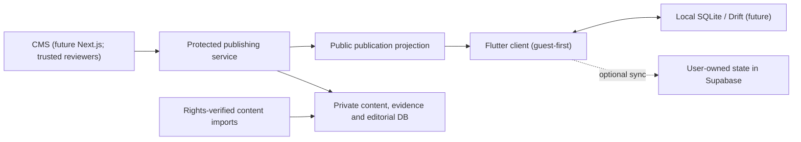

# ADR-0001 — Architecture and trust boundaries

**Task:** P00-05 · **Date:** 2026-11-19 · **Decision:** Adopted as the P00-05 engineering design baseline after PR #14 merge, under owner's delegation. No production backend or SQL deployment is implied.

## Purpose and decision
Use an **offline-first Flutter modular monolith** for Android (future iOS), and a **publication-only API projection** for approved materials. Separate trusted editing from guest users and ordinary authenticated clients. Keep religious integrity and rights checks **outside** generic automated CI checks.

### Deployment boundaries

### Mobile
- Existing `apps/mobile/lib/app` owns app composition, Riverpod scopes, GoRouter, ARB localization and accessibility. Do not replace the working P00-06 shell.
- Features have `presentation`, `application`, `domain`, `data` boundaries. `domain` contains immutable IDs, policies, repository interfaces; `data` contains adapters; UI never imports remote SQL credentials.
- State: Riverpod Notifier/AsyncNotifier at feature boundaries. Navigation stays GoRouter indexed tabs. Expose loading/offline/error states explicitly.
- Current guest preferences: local `shared_preferences`. **Future** local SQL: Drift/SQLite for Quran dataset, search index, bookmarks, audio-cache index, khatmah. Not installed yet.
- Quran reference identity is `(edition_id, surah_number, ayah_number)` **everywhere**, matching existing `AyahRef`.
- No mandatory login, no remote request on start, no location history collection. Optional account and sync must not overwrite guest data without explicit merge confirmation.

### Quran data
- Import only a **verified immutable edition** after P00-07 (source, rights, exact release and SHA-256). Android client may bundle or download it according to license.
- Display text is byte-preserved for that edition. Normalize only *derived search tokens*. Never change a Quran text edition in place.
- Surah range `1..114`; the verified edition manifest supplies counts (commonly 6236 for the planned numbering), mapping and page layout; do not hardcode a global edition-independent total.
- Copy-on-version-change or a new edition ID. Reading positions/bookmarks remain edition-aware; no automatic cross-edition mapping without verified mapping data.
- Translation/tafsir and audio are independently versioned, attributed, and rights-gated. Providers may prohibit offline caching.

### Prayer & Qibla
- Prayer times computed **on device**. GPS optional; manual city always available. Calculation method, Asr rule, locale time zone and daylight saving configurable and versioned.
- Benchmarks P00-10: UAE (Dubai/Abu Dhabi), Egypt (Cairo/Alexandria); published official reference fixtures only. No claim that calculation results are official.
- Compass accuracy and availability are separate from mathematically derived Qibla bearing.

### Backend & CMS
- Selected **target architecture**, not a deployed service: Supabase Postgres/Auth/Storage plus protected server-side editor/publishing API, and future Next.js CMS.
- Private schema `mh_private`: original source/rights records, Quran registry, content revisions, scholarly reviews, audit, fiqh citations. **Never expose this schema via Data API.**
- Exposed `public` projection: publication-approved content rows (read-only to clients) and owner-scoped optional account state. Direct `anon` or `authenticated` publishing is forbidden.
- Trusted publishing service verifies source rights, independent scholarly review for fiqh/attributed hadith/stories, required AR/EN review, and writes an append-only audit event. Withdrawal revokes future distribution; the mobile client must enforce a revocation manifest and refresh behavior for licensed cached data.
- Service secrets are server-side only, never in Flutter, public JS, CI logs or GitHub. No direct client access to source-rights evidence.
- Do **not** allow `user_metadata` to set editorial roles. Even trusted JWT app-metadata is potentially stale; reviewer privileges checked against server-owned role records on each approval action.
- No security-definer RPC in exposed schemas. Use strictly reviewed server-side services for privileged editorial actions.

### Failure modes and security
- Offline client: reading and user records work locally; optional synced content shows an explicit unavailable state.
- API unavailable: no blocking splash/login; stale content displayed only if rights permit and revocation rules are respected.
- Withdrawal/rights expiry: stop serving the affected content and invalidate cache according to rights policy.
- Never equate missing fiqh coverage with consensus. No automated personal fatwa.

### Deferred, explicitly not implemented by this ADR
No live Supabase project, account migration, Next.js CMS, storage buckets, migration execution, source ingestion, Quran font embedding, licensed audio, or prayer calculation in P00-05. Implementation and tests belong to their downstream phase IDs.

## Verification and references
- Existing P00-06 app modules and `AyahRef` contracts inspected.
- [ERD](ERD.md), [RLS policy matrix](RLS_MATRIX.md), [schema blueprint](SCHEMA_BLUEPRINT.sql) and [threat model](THREAT_MODEL.md) form the design contract.
- Supabase docs verified 2026-11-19: https://supabase.com/docs/guides/database/postgres/row-level-security and https://supabase.com/docs/guides/api/securing-your-api
- Supabase changelog checked 2026-11-19: https://supabase.com/changelog — supabase-flutter v3 breaking changes announced. **Do not install a client until current stable API/version is rechecked; pin the selected version.**
