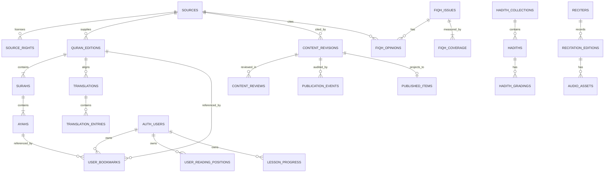

# P00-05 — Canonical ERD and invariants

This is the **logical target schema**. [SCHEMA_BLUEPRINT.sql](SCHEMA_BLUEPRINT.sql) contains an isolated SQL design sample for the most security-critical tables; it is **not a migration** and has not been run against a database.

## Keys / constraints

| Area | Primary/composite key | Invariants |
|---|---|---|
| `sources`, `source_rights` | source UUID; rights revision UUID | Legal holder, exact edition, permission evidence, cache, attribution, expiry and withdrawal recorded; never default to approved |
| `quran_editions` | stable immutable `edition_id` | riwayah, source release, manifest SHA-256, license reference, edition-specific totals |
| `surahs` | (`edition_id`, `surah_number`) | surah 1–114, source-approved ayah count |
| `ayahs` | (`edition_id`, `surah_number`, `ayah_number`) | composite FK to surahs; original Uthmani text immutable; count validated against manifest |
| `translations`, `translation_entries` | translation UUID; (translation ID + edition/surah/ayah) | versioned copyright, exact verse FK; language review |
| `tafsir_books`, `tafsir_entries` | book + edition UUID; entry UUID | quote source/edition and start/end ayah refs |
| `audio_assets` | recording edition UUID + surah | stream/download/cache rights per asset, expiry and segments optional |
| `fiqh_issues` | UUID | canonical topic, question scope and locality if relevant |
| `fiqh_opinions` | UUID | issue, madhhab `hanafi|maliki|shafii|hanbali`, view qualifier, source locator, scholarly approval |
| `fiqh_coverage` | (issue UUID, madhhab) | `not_researched|draft|in_review|verified|withdrawn` — unknown never implies consensus |
| `hadiths`, `hadith_gradings` | collection/number ID; grading UUID | explicit collection and source, judge/grader and exact grading provenance |
| `content_revisions` | revision UUID | insert-only; previous revision linked; approval has reviewer identity/time |
| `content_reviews` | review UUID | separate source rights, scholarly, AR copy and EN copy decisions |
| `published_items` | content UUID + revision UUID | public projection after **all required gates**; direct client writes forbidden |
| `user_bookmarks` | user UUID + bookmark UUID | `auth.uid()` owner; edition-aware reference; deleted on opt-in account deletion |
| `user_reading_positions` | user UUID + edition UUID | bookmarks survive network outage; conflict resolution last explicit user action |
| `lesson_progress` | user UUID + lesson UUID | owner-only; client may update own progress but never lesson content |

## Editorial states
`draft → source_verified → scholarly_reviewed → language_reviewed → approved → published`; `withdrawn` supersedes any published version. For non-fiqh material, required scholarly gate is determined by a **server-owned rule**, not a client flag. Approval is not equivalent to `published`; publication is a separate, audited action.

## Data movement
Guest state remains in local encrypted/ordinary app storage as appropriate; no secret tokens or sensitive location histories. Optional account sync performs identity check, explicit guest-data merge, edition mapping check and conflict handling. Only an approved publication projection and user-owned records are client-visible.
